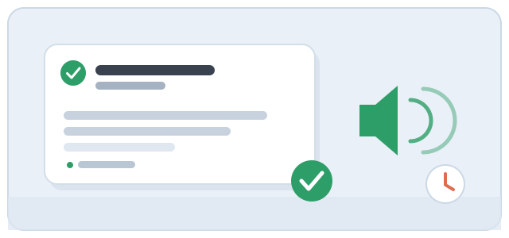

# Task completion notice

Play a sound and get a Windows desktop notification when a DeepSeek Harness turn finishes, so you can move on to other work while the agent runs.



## What it does

- Listens to the persistent session events `turn/start`, `assistant/message` and `turn/end`. It does not poll, add model requests or write session logs.
- Title: `Task completed · <workspace folder>`. Body: the last reply of the turn (flattened to one line and truncated) plus the elapsed time.
- A turn that ended in an error uses the `Task ended with an error` title and the system error sound. Synthetic `interrupted` and `forked` markers (crash repair, fork cleanup) stay silent.
- Subagent turns are silent by default, so one task with subagents does not flood the desktop.
- Delivery: a hidden `powershell.exe` child process runs `lib/notify.ps1`. It prefers a Windows toast, falls back to a tray balloon, and `style: window` shows a small corner window instead. A failure never interrupts the session.

## Requirements

- Windows 10 or Windows 11. The plugin stays idle on other platforms.
- DeepSeek Harness `>=0.2.2-rc.5 <0.3.0`.

## Install

- From a plugin index: open **Plugins** → **Discover**, add the index URL, then install **Task completion notice**.
- From a published package: install `dsh-task-complete-notice` with the plugin manager, or run `plugin_manager` `install_bundle` with the package name.
- From this folder: **Plugins** → **Add plugin** and pick the directory (or the packed `.tgz`).

## Configuration

The keys live under `config` in the bundle's `cordis.patch.yml` row; DSH settings can override them.

| Key | Default | Meaning |
|---|---|---|
| `enabled` | `true` | Master switch. The plugin still loads when `false` but sends nothing. |
| `sound` | `default` | `default` plays the system sound, `none` is silent, any other value is an absolute path to a WAV file. |
| `style` | `toast` | `toast` shows a desktop notification; `window` shows a corner window that takes focus briefly and closes after 8 seconds. |
| `notifyOnError` | `true` | Also notify turns that ended with an error or hit a limit. |
| `skipSubagents` | `true` | Keep subagent turns silent. |
| `minTurnDurationMs` | `0` | Only notify turns longer than this many milliseconds; `0` notifies every turn. |
| `maxBodyChars` | `140` | Truncation length of the body excerpt. |
| `title` / `errorTitle` | `Task completed` / `Task ended with an error` | Notification titles. |
| `appId` | `com.deepseek.dsh` | AppUserModelID that decides the sender name Windows shows. |

## Why the sender says DeepSeek Harness

The line at the top of a Windows notification is the display name of an **AppUserModelID (AUMID)**, not the process that posted the notification — the toast is still posted by a hidden `powershell.exe`.

- The PowerShell AUMID (`{1AC14E77-…}\WindowsPowerShell\v1.0\powershell.exe`) makes Windows show **Windows PowerShell**.
- The plugin posts under the DeepSeek Harness AUMID `com.deepseek.dsh`, registered by the desktop app's Start-menu shortcut, so Windows shows **DeepSeek Harness** with the app icon. The notification also appears under DeepSeek Harness in Windows notification settings, where it can be muted on its own.
- If that AUMID is missing on a machine, the script falls back to the PowerShell AUMID so the notification still appears; the trace log then records `shown=toast-fallback`. Change `appId` to any AUMID registered on that machine to use another name.

## Limitations

- Windows only.
- Focus Assist / Do Not Disturb can swallow toasts; the sound still plays. Use `style: window` when the toast never shows up.
- The sound follows the system volume and the system sound settings.
- Queued input that produces several turns in a row notifies once per turn.
- Every notification starts one short-lived hidden `powershell.exe` process (about a second of CPU work).

## Manual test

```powershell
$payload = '{"title":"Task completed · test","body":"Preview of the sound and the notification","sound":"default","style":"toast","kind":"info","appId":"com.deepseek.dsh"}'
$file = Join-Path $env:TEMP 'dsh-notice-test.json'
[System.IO.File]::WriteAllText($file, $payload, (New-Object System.Text.UTF8Encoding($false)))
powershell.exe -NoProfile -ExecutionPolicy Bypass -File .\lib\notify.ps1 -PayloadFile $file
```

The last lines of `%TEMP%\dsh-task-notice.log` record what was shown, in which style, and under which AUMID.

## Changelog and license

See [CHANGELOG.md](CHANGELOG.md) and [LICENSE](LICENSE) (MIT).
